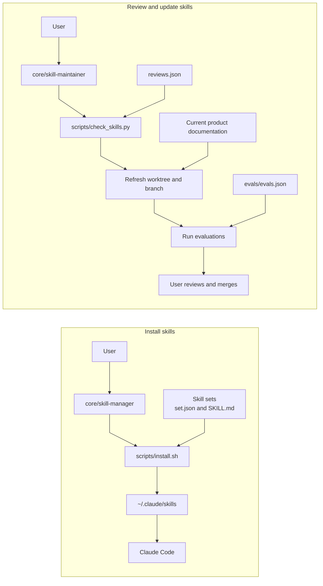

# Design

## Purpose

This repository stores Claude Code skills in sets. The `core` set contains skills that manage the repository. Scripts perform local checks and file operations.

## Components

| Component | Responsibility |
| --- | --- |
| Skill sets | Store skill instructions, set metadata, and evaluation prompts. |
| `core/skill-manager` | Provides a user-facing way to manage installed skill sets. |
| `core/skill-maintainer` | Prepares tested skill updates for review. |
| `scripts/install.sh` | Manages links from skill sets to the Claude Code skills folder. |
| `scripts/check_skills.py` | Reports review status and possible stale details. |
| `reviews.json` | Stores skill review records. |

## Component relationships

## Design choices

- **Use symbolic links for installed skills.** The repository stays the source of truth. A change to a linked skill is available without copying the files.
- **Use one shared skills folder.** Claude Code finds skills in one folder. Skill names must therefore be unique across sets.
- **Limit installer changes to links owned by this repository.** This protects files and links that belong to the user or to another tool.
- **Use a worktree for skill maintenance.** Installed skills link to the main checkout. A separate worktree keeps draft updates out of the active skills until the user reviews and merges them.
- **Keep the checker local and deterministic.** It reports possible issues without making AI calls or changing files. A person decides whether a finding needs an update.

## Related documentation

- [Repository overview and setup](./README.md)
- [Core skills](./core/README.md)
- [Skill-manager instructions](./core/skill-manager/SKILL.md)
- [Skill-maintainer instructions](./core/skill-maintainer/SKILL.md)
- [Script commands](./scripts/README.md)
